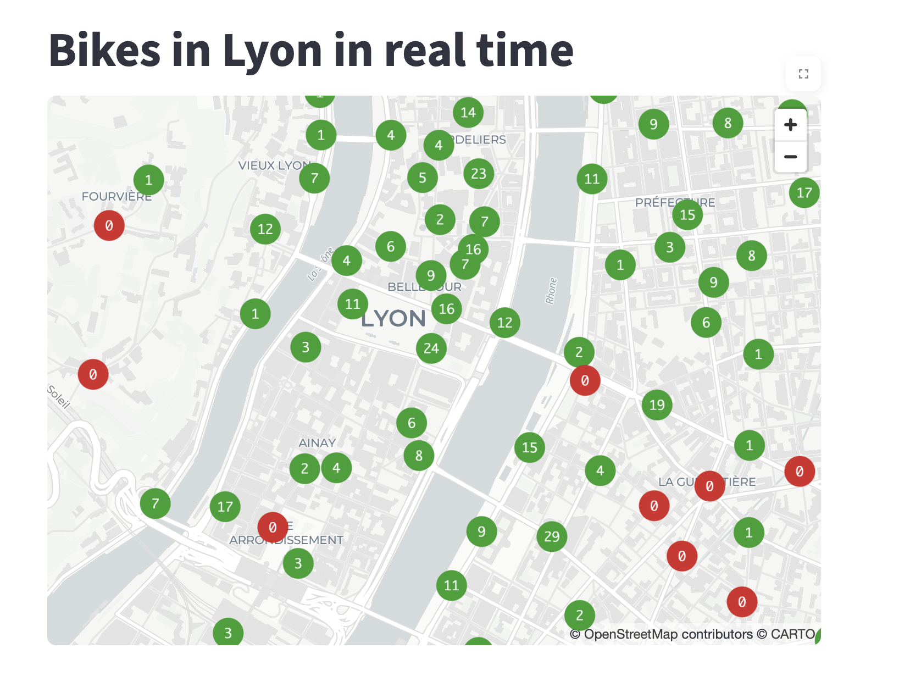
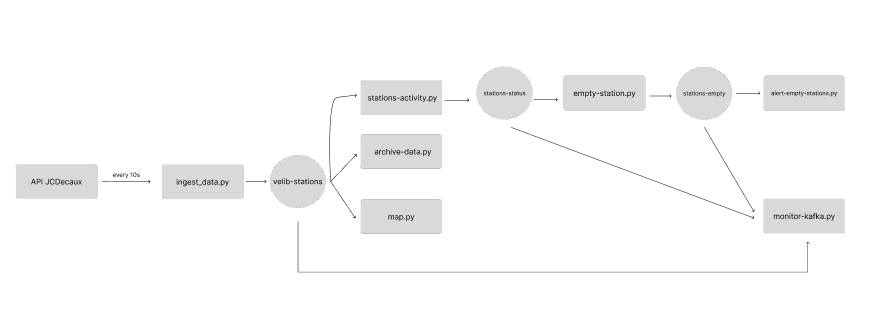

Real-time bike-sharing pipeline with Kafka

This project is a data pipeline that collects real-time bike-sharing data from the JCDecaux API,
processes it with Apache Kafka and displays the available bikes in Lyon on a live map with streamlit and pydeck.

Architecture

Getting started
Prerequisite
- Python 3.10+
- Java 17+ (for kafka)
- Apache Kafka 
- A free JCDecaux API key: developer.jcdecaux.com

Installation

git remote add origin https://github.com/dzabala-code/velo-kafka-pipeline.git
cd velo-kafka.pipeline
pip install -r requirements.txt
export JCDecaux_API_KEY='your api'

Start Kafka

KAFKA_CLUSTER_ID="$(bin/kafka-storage.sh random-uuid)"
bin/kafka-storage.sh format --standalone -t "$KAFKA_CLUSTER_ID" -c config/server.properties
bin/kafka-server-start.sh config/server.properties

Create topics in another terminal 

for t in ['velib-stations', 'stations-status,'empty-stations'] do
    bin/kafka-topics.sh --create --bootstrap-server localhost:9092 --replication-factor 1 --partitions 1 --topic $t
done

Run the pipeline

Each script on his own terminal

python ingest-data.py         
python stations-activity.py
python empty-station.py
python alert-empty-station.py
python archive-data.py
python monitor-kafka.py
streamlit run map.py

What i learned

- It was my first time using Kafka so i learned about consumer and producer and all of the syntax behind.
- I learned a lot about json decoder to fit kafka.
- I also learned for the first time to do real-time display using streamlit

Possible improvements

- Add the official Velib Metropole API to add Paris
- Show the stations name on hover

